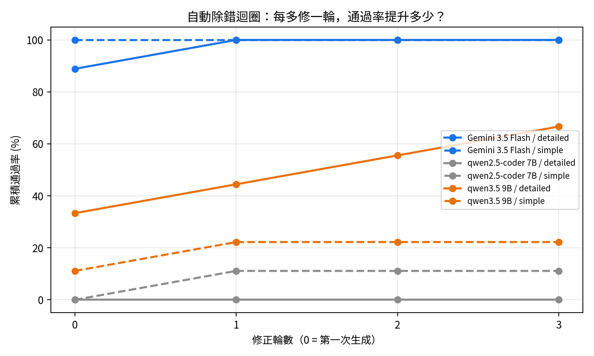
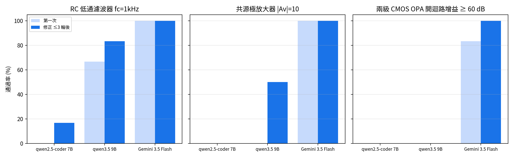

# AI 生成 SPICE 能力比較：本機小模型 vs 雲端大模型

用大型語言模型（LLM）自動產生類比電路的 SPICE netlist，再用 **ngspice 自動模擬驗證**，比較不同模型、不同 Prompt 詳細程度，以及 **加入自動除錯迴圈** 後的正確率。

> 電路模擬實習 期末專題（Part 2：AI-driven SPICE 設計）

**研究問題：AI 能不能設計類比電路？小模型有了錯誤回饋，能不能追上大模型？**

## 實驗設計

| 項目 | 內容 |
|---|---|
| 模型 | qwen2.5-coder 7B、qwen3.5 9B（本機 / Ollama）、Gemini 3.5 Flash（雲端 API） |
| 題目 | ① RC 低通濾波器 fc = 1 kHz ② 共源極放大器 \|Av\| = 10 (20 dB) ③ 兩級 CMOS OPA 開迴路增益 ≥ 60 dB |
| Prompt | **simple**：只給規格；**detailed**：加上拓樸、MOS 模型參數、手算步驟 |
| 驗證 | ngspice AC 分析（1 Hz – 1 GHz），程式自動量測 fc / 增益並判定是否達規格 |
| 環境 | Google Colab（GPU） |

| 版本 | 內容 | 組數 |
|---|---|---|
| **v1** | 每組生成 1 次，不修正 | 3 模型 × 3 題 × 2 Prompt = 18 |
| **v2** | 每組重複 3 次；失敗時把 ngspice 錯誤訊息或「量測值 vs 規格」回傳給 AI，**最多修正 3 輪** | 18 × 3 = 54 |

### 通過標準
| 題目 | 通過條件 |
|---|---|
| RC 低通 | -3 dB 頻率在 900–1100 Hz |
| CS 放大器 | 1 kHz 增益在 17–23 dB |
| 兩級 OPA | 10 Hz 增益 ≥ 60 dB |

## v2 結果：自動除錯迴圈

| 模型 | 第一次通過 | 修正 ≤3 輪後 |
|---|---|---|
| qwen2.5-coder 7B | 0/18（0%） | 1/18（6%） |
| qwen3.5 9B | 4/18（22%） | **8/18（44%）** |
| Gemini 3.5 Flash | 17/18（94%） | 18/18（100%） |



| 題目（每格滿分 6） | qwen2.5 7B | qwen3.5 9B | Gemini |
|---|---|---|---|
| RC 低通 | 0 → 1 | 4 → 5 | 6 → 6 |
| CS 放大器 | 0 → 0 | **0 → 3** | 6 → 6 |
| 兩級 OPA | 0 → 0 | 0 → 0 | 5 → 6 |



### 修得好 vs 修不好
- ✅ **輸出節點命名錯、缺 `.model`**：qwen3.5 收到 ngspice 錯誤後 1–3 輪修好，CS 放大器 0/3 → 3/3
- ✅ **回授極性接反**：Gemini 收到「增益未達 60 dB」回饋後 1 輪修正差動對正負端，增益 86 dB
- ❌ **qwen2.5 7B 看不懂錯誤訊息**：10/18 組連續 3 輪犯完全相同的錯；11/18 組把英文說明直接寫進 netlist，越修越糟
- ❌ **設計觀念錯誤**：qwen3.5 CS simple 語法修好但拓樸錯（增益 -134 dB），3 輪找不到原因；兩級 OPA qwen 全部失敗

完整分析：[`results_v2/結果分析_v2.md`](results_v2/結果分析_v2.md)

## v1 結果：單次生成

| 模型 | RC simple | RC detailed | CS simple | CS detailed | OPA simple | OPA detailed | 通過 |
|---|---|---|---|---|---|---|---|
| qwen2.5-coder 7B | 語法錯 | 語法錯 | 重複命名 | 拓樸錯 | 無限重複 | 參數錯 | **0/6** |
| qwen3.5 9B | 做成高通 | ✅ 992 Hz | 缺 model | 重複命名 | 語法錯 | 短路電源 | **1/6** |
| Gemini 3.5 Flash | ✅ 998 Hz | ✅ 998 Hz | ✅ 20.00 dB | ✅ 19.99 dB | 單位錯 (0 dB) | 正回授 (-44 dB) | **4/6** |

- **Gemini — 單位陷阱**：寫 `1F` 想表示 1 法拉，但 SPICE 的 `F` 是 femto（1 fF），回授沒被 AC 斷開，變成電壓隨耦器
- **Gemini — 回授極性**：差動對正負輸入接反 → DC 正回授，輸出卡在電源軌

完整分析：[`results/結果分析.md`](results/結果分析.md)

## 結論
1. **模型越大越好**：第一次通過率 7B 0% → 9B 22% → 雲端 94%。
2. **錯誤回饋讓 9B 模型通過率翻倍（22% → 44%）**，但對 7B 幾乎無效 → 回饋迴圈有用的前提是模型看得懂錯誤訊息。
3. **Prompt 與回饋會疊加**：qwen3.5 detailed 33% → 67%，simple 只有 11% → 22%。
4. **AI 修得好語法，修不好設計觀念**；複雜電路（兩級 OPA）仍需懂電路的人驗證。
5. **單次實驗不可靠**：v1 Gemini OPA 0/2，v2 重複後第一次通過 5/6，所以需要重複實驗。

## 限制
- Level-1 MOS 模型、無寄生電容，頻寬不代表真實電路
- simple Prompt 的 OPA 測試電路沒有 DC 回授，靠模擬中元件完全匹配才偏壓在高增益區
- 每組 3 次，樣本仍小；Gemini 免費 API 有每日額度上限
- 生成時間包含 API 等待重試，不代表模型本身速度

## 如何重現
1. 在 Colab 開啟 [`ai_spice_benchmark_v2.ipynb`](ai_spice_benchmark_v2.ipynb)（v1：[`ai_spice_benchmark.ipynb`](ai_spice_benchmark.ipynb)），執行階段選 **L4 或 T4 GPU**。
2. 左側 🔑 密鑰新增 `GEMINI_API_KEY`（[Google AI Studio](https://aistudio.google.com) 申請），開啟筆記本存取權。
3. 先執行第 0 格掛載 Google Drive，再「全部執行」。結果逐組寫入 Drive，斷線可續跑。

## 檔案
```
ai_spice_benchmark.ipynb      v1 筆記本
ai_spice_benchmark_v2.ipynb   v2 筆記本（除錯迴圈 + 重複實驗）
plot_results.py               從 .dat 重畫中文頻率響應圖
results/                      v1：18 組的 .txt / .sp / .cir / .log / .dat、results.csv、結果分析.md、圖
results_v2/
  results.csv                 54 組總表（history 欄 = 每輪狀態，如 sim_error → pass）
  cumulative_pass_rate.csv    各輪累積通過率
  結果分析_v2.md               完整分析
  plot_*.png                  圖表
  raw_outputs.zip             每組每輪的 Prompt、AI 回答、netlist、ngspice log（檔名 …__r2__fix1 = 第 2 次重複、第 1 輪修正）
```
