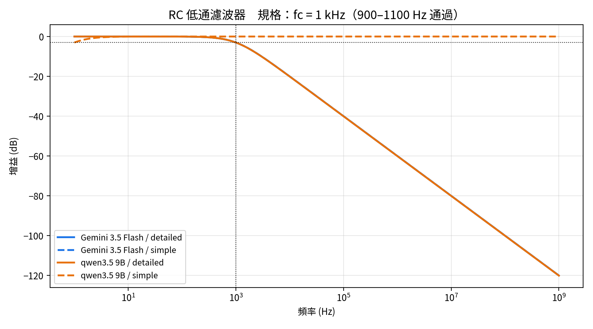
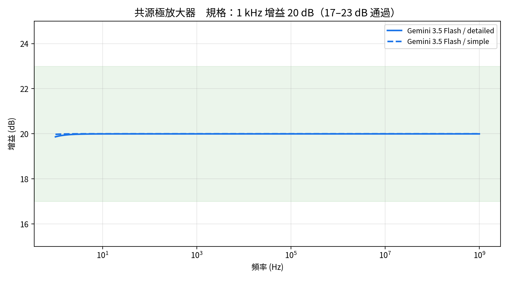
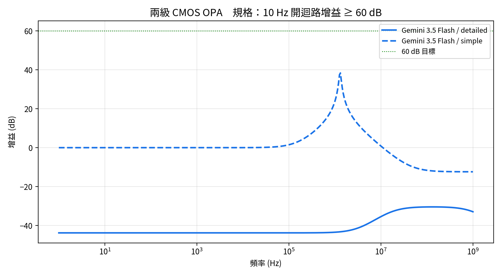

# AI 生成 SPICE 能力比較：本機小模型 vs 雲端大模型

用大型語言模型（LLM）自動產生類比電路的 SPICE netlist，再用 **ngspice 自動模擬驗證**，比較不同模型與不同 Prompt 詳細程度的正確率。

> 電路模擬實習 期末專題（Part 2：AI-driven SPICE 設計）

## 實驗設計

| 項目 | 內容 |
|---|---|
| 模型 | qwen2.5-coder 7B（本機 / Ollama）、qwen3.5 9B（本機 / Ollama）、Gemini 3.5 Flash（雲端 API） |
| 題目 | ① RC 低通濾波器 fc = 1 kHz ② 共源極放大器 \|Av\| = 10 (20 dB) ③ 兩級 CMOS OPA 開迴路增益 ≥ 60 dB |
| Prompt | **simple**：只給規格；**detailed**：加上拓樸、MOS 模型參數、手算步驟 |
| 驗證 | ngspice AC 分析（1 Hz – 1 GHz），程式自動量測 fc / 增益並判定是否達規格 |
| 環境 | Google Colab（T4 GPU） |

共 3 模型 × 3 題 × 2 Prompt = **18 次生成**。

### 通過標準
| 題目 | 通過條件 |
|---|---|
| RC 低通 | -3 dB 頻率在 900–1100 Hz |
| CS 放大器 | 1 kHz 增益在 17–23 dB |
| 兩級 OPA | 10 Hz 增益 ≥ 60 dB |

## 結果

| 模型 | RC simple | RC detailed | CS simple | CS detailed | OPA simple | OPA detailed | 通過 |
|---|---|---|---|---|---|---|---|
| qwen2.5-coder 7B | 語法錯 | 語法錯 | 重複命名 | 拓樸錯 | 無限重複 | 參數錯 | **0/6** |
| qwen3.5 9B | 做成高通 | ✅ 992 Hz | 缺 model | 重複命名 | 語法錯 | 短路電源 | **1/6** |
| Gemini 3.5 Flash | ✅ 998 Hz | ✅ 998 Hz | ✅ 20.00 dB | ✅ 19.99 dB | 單位錯 (0 dB) | 正回授 (-44 dB) | **4/6** |

### 失敗類型
| 狀態 | qwen2.5 7B | qwen3.5 9B | Gemini |
|---|---|---|---|
| ✅ pass | 0 | 1 | 4 |
| 跑得動但沒達規格 | 0 | 1 | 2 |
| ngspice 報錯（跑不動） | 5 | 4 | 0 |
| 沒產出 netlist | 1 | 0 | 0 |

### 頻率響應
| RC 低通 | CS 放大器 | 兩級 OPA |
|---|---|---|
|  |  |  |

### 值得注意的錯誤
- **Gemini — 單位陷阱**：寫 `Cac in_m 0 1F` 想表示 1 法拉，但 SPICE 的 `F` 是 femto（1 fF），回授沒被 AC 斷開，電路變成電壓隨耦器，增益 0 dB。
- **Gemini — 回授極性**：差動對正負輸入接反，DC 偏壓回授變成正回授，輸出卡在電源軌，增益 -44 dB。
- **qwen3.5 9B**：RC 題把電容串聯、電阻接地，做成高通濾波器。
- **qwen2.5-coder 7B**：使用不存在的 `.out` 指令、電源重複定義，OPA 題陷入無限重複輸出。

每題的完整分析見 [`results/結果分析.md`](results/結果分析.md)。

## 結論
1. **模型越大越新越好**：7B 0/6 → 9B 1/6 → 雲端 4/6。
2. **小模型多半死在語法**：11 次失敗中 9 次 ngspice 直接報錯；大模型語法全對，錯在電路設計觀念（回授極性、單位）。
3. **詳細 Prompt 對小模型有幫助**（qwen3.5 只有 detailed 版通過），但救不回複雜電路。
4. **簡單電路 AI 已能可靠完成；兩級 OPA 三個模型全失敗** → 仍需要懂電路的人用 EDA 驗證與修正。

## 限制
- 每個組合只跑 1 次（18 個樣本），屬初步觀察，非嚴謹統計；可把 `REPEAT` 改成 3 以上算正確率。
- 使用 Level-1 MOS 模型、無寄生電容，因此增益一路平到 1 GHz，頻寬不代表真實電路。
- Gemini 在 503/504 塞車時會等待重試，生成時間不代表模型本身速度。

## 如何重現
1. 在 Colab 開啟 [`ai_spice_benchmark.ipynb`](ai_spice_benchmark.ipynb)，執行階段選 **T4 GPU**。
2. 左側 🔑 密鑰新增 `GEMINI_API_KEY`（[Google AI Studio](https://aistudio.google.com) 申請，免費額度即可），開啟筆記本存取權。
3. 先執行第 0 格掛載 Google Drive，再「全部執行」。結果會逐題寫入 Drive，斷線可續跑。

## 檔案
```
ai_spice_benchmark.ipynb   Colab 筆記本（安裝 → 生成 → 模擬 → 統計 → 繪圖）
plot_results.py            從 .dat 重畫中文頻率響應圖
results/
  results.csv              18 次實驗總表
  結果分析.md               逐題失敗原因與結論
  plot_*.png               頻率響應圖
  <模型>__<題目>__<prompt>__r1.txt   Prompt 與 AI 原始回答
                         .sp    AI 產生的 netlist
                         .cir   實際送進 ngspice 的 netlist（加上量測指令）
                         .log   ngspice 輸出 / 錯誤訊息
                         .dat   AC 分析結果（頻率, dB）
```
